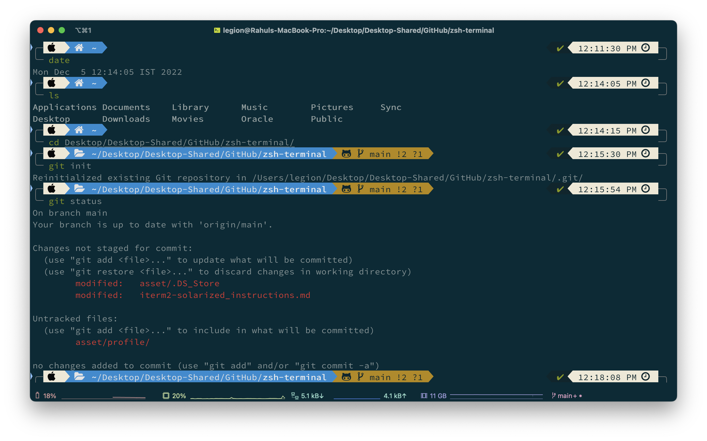

# Mac environment, as code

[](https://github.com/RahulSinghParmar/zsh-terminal/actions/workflows/check.yml)

My Mac shell and development-tool setup, captured as reviewable manifests and portable configuration—with a separate private backup for exact recovery. The goal: rebuild my familiar terminal on a replacement Mac without remembering dozens of install commands or leaking my credentials into Git.

## The setup captured here

| Layer | Current configuration |
| --- | --- |
| Machine | Intel/x86_64 Mac; Homebrew under `/usr/local` |
| Shell | Zsh + Oh My Zsh + Powerlevel10k lean prompt |
| Terminal | iTerm2, MesloLGS NF, current default profile's colors/display settings |
| Navigation | nnn, fzf, zoxide, eza, bat, ripgrep, fd |
| Monitoring | bpytop, btop, htop |
| History | Atuin integration; history/account data stays private |
| Development | Node/NVM, Python, Git/GitHub CLI, tmux, Neovim, VS Code and other captured tools |
| Homebrew snapshot | **235 formulae, 7 casks, 2 custom taps**, including dependency libraries |

This is **Powerlevel10k**, not Oh My Posh. Its current look is retained rather than replaced. Upstream Powerlevel10k [reports very limited support](https://github.com/romkatv/powerlevel10k); source revisions are recorded, and future prompt migrations should be explicit.



_Historical appearance reference, not a screenshot of a newly restored Mac. Current configuration is in `dotfiles/` and `iterm2/`._

## Restore in one command

After cloning the repository and reviewing the manifests:

```sh
./setup.sh restore --profile full --extras --apply --install-homebrew
```

This installs the recorded Homebrew package set plus the core terminal/font toolkit, missing pinned shell repositories, portable configuration, and optional captured NVM/npm/pipx/VS Code extras. Homebrew bootstrap is explicit and interactive if needed; existing installations are reused. OS/admin confirmations, first-time app permissions, and account sign-ins cannot safely be eliminated.

**Preview first**, without changing your Mac:

```sh
git clone https://github.com/RahulSinghParmar/zsh-terminal.git
cd zsh-terminal
./setup.sh restore --profile full --extras
```

Requires Python 3.9+ for the manager and Git/Apple Command Line Tools for cloning. `--install-homebrew --apply` can install missing Homebrew/Python through the official installer; do not run as root. See the [fresh-Mac runbook](docs/RESTORE.md#fresh-or-replacement-mac).

Prefer a smaller setup? Use `--profile core`. Omit `--extras` to skip captured runtime/editor extension installs. For configuration only: `./setup.sh restore --configs-only --apply`.

## Two recovery layers

| Public, portable repo | Private, exact settings backup |
| --- | --- |
| Package names, installed-version inventory, source revision lock | Raw shell/tool/editor preferences and user fonts |
| Cleaned shell initialization and current Powerlevel10k/tool preferences | Complete captured iTerm profiles, keybindings and UI preferences |
| iTerm appearance-only dynamic profile with a new stable GUID | Stored under Git-ignored `local/backups/` with checksums and private permissions |
| Safe to review for publication—not an automatic guarantee of privacy | Unencrypted: protect it and keep an encrypted off-machine copy |

The portable profile adds **Rahul · Main** to iTerm2 without replacing your default profile or copying host-specific commands. For exact full iTerm recovery, quit iTerm2 and use the private backup from Apple Terminal. [Recovery instructions](docs/RESTORE.md#full-iterm-settings).

## Keep it up to date

```sh
./setup.sh backup               # Exact allowlisted settings: local/private only
./setup.sh snapshot --settings  # Refresh public package/appearance exports
./setup.sh check                # Validate manifests and screen obvious private values
git diff                       # Review before committing anything
```

No automatic uploads, commits, schedules, or background services are installed. Shell history, Atuin account/history keys, SSH/cloud/GitHub credentials, and editor account databases are excluded. Raw shell/editor/full-iTerm preferences are never copied into the public snapshot. Privacy checks are heuristic; review diffs yourself.

`manifests/inventory.json` records capture time, package versions, service states, runtime/extension inventories, and warnings. The inspected Mac's pipx inventory command failed; its installed apps have **not** been verified. Fix that locally and refresh before relying on pipx recovery.

## What changes—and what does not

- Default restore is a **preview**. Only `--apply` installs packages or replaces configuration. Existing files are backed up before replacement; identical files are left alone.
- Homebrew paths adapt to Intel and Apple Silicon. The managed shell removes duplicate NVM initialization, guards optional tools/Java, and avoids a hardcoded TeX year. Private additions belong in `.zshrc.local` or `.zprofile.local`.
- Package installation uses `--no-upgrade` and never runs cleanup/uninstall or starts services. Required dependency changes and administrator prompts can still occur.
- Existing Oh My Zsh/plugin/theme directories are retained rather than reset. Missing sources use recorded Git commits. `./setup.sh doctor` reports differences and Homebrew ownership gaps.
- Configuration is copied, not symlinked to this checkout. The old files can be recovered from the printed transaction backup. Package installation is not rolled back by configuration recovery.

Homebrew restores available packages by name, not exact historical binaries. The full snapshot was captured on Intel; availability/support on another Mac can differ. This is not a full disk image, dependency lockfile for every project, or backup of every application/account. Keep Time Machine or an equivalent full-machine backup alongside it. [Scope, migration limits, and rollback](docs/RESTORE.md).

## Repository map

```text
setup.sh                       One entry point; macOS Bash compatible
scripts/macenv.py              Standard-library-only inventory/backup/restore manager
Brewfile                       Small portable shell and developer toolkit
manifests/Brewfile.full         Every captured Homebrew formula/cask/tap
manifests/inventory.json        Version/reference inventory and capture warnings
manifests/shell-sources.json    Pinned Oh My Zsh/theme/plugin source commits
dotfiles/                      Portable shell, Powerlevel10k, and tool preferences
iterm2/Profiles.json            Sanitized dynamic appearance profile
local/backups/                 PRIVATE and Git-ignored; never upload
tests/                         Offline tests using temporary fake home directories
docs/RESTORE.md                Fresh-Mac, backup, migration, recovery, undo
```

See [security](SECURITY.md), [contributing/testing](CONTRIBUTING.md), [change notes](CHANGELOG.md), and [third-party notices](THIRD_PARTY_NOTICES.md). Existing `asset/` files and manual guides are historical references, not the supported installer. Original repository code has no selected open-source license yet; upstream material keeps its own terms.

### Upstream references

[Homebrew installation](https://docs.brew.sh/Installation) · [Brewfiles](https://docs.brew.sh/Brew-Bundle-and-Brewfile) · [iTerm dynamic profiles](https://iterm2.com/documentation-dynamic-profiles.html) · [Powerlevel10k fonts](https://github.com/romkatv/powerlevel10k/blob/master/font.md)
